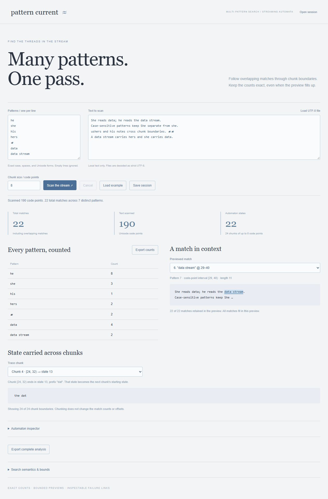

# Pattern Current

A streaming multi-pattern search workbench using Aho–Corasick. Inspect overlapping matches, failure links, and state carried between chunks while retaining exact aggregate counts for dense match streams.



## Run

Requires Python 3.10+. No runtime dependencies or API keys.

```sh
python run.py --port 8000
```

Open http://127.0.0.1:8000/. Search runs in a cancellable browser worker. No data is uploaded. Save the scanned session before refreshing.

## Workflows

- Enter up to 100 literal patterns and scan text or a strict UTF-8 file.
- Change chunk size without changing counts or match offsets.
- Inspect exact per-pattern totals and a bounded preview of overlapping matches with highlighted context.
- Follow the automaton state and matched prefix carried across chunk boundaries.
- Inspect trie states, failure targets, and inherited outputs; export the complete automaton as DOT.
- Save/reopen sessions and export counts CSV or complete analysis JSON.

[Example session](docs/example.json) contains seven patterns, 190 code points, and 22 matches. A `data stream` match spans [29,40), crossing a boundary at code point 32 when chunk size is eight. [UTF-8 line-ending fixture](docs/utf8-lines.txt) preserves CRLF and a supplementary-plane character; Git treats it as an exact-byte fixture.

## Algorithm and output bounds

Compilation builds a trie, breadth-first failure links, and inherited terminal outputs. Scanning retains the current automaton state between chunks. Every consumed code point increments the visited state's counter. After scanning, visit counts propagate backwards through failure links; terminal-state counts give exact occurrence totals, including overlaps, without enumerating all occurrences.

The interface retains the first 2,000 match records and first 128 chunk boundaries. Full counts still cover the complete text after the preview fills. At a shared end position, longer terminal matches appear before inherited suffix matches. The automaton inspector shows the first 80 states; DOT and analysis exports include every state. Analysis JSON includes exact counts plus the bounded match/chunk previews, not an unbounded occurrence list.

Core `compile`, `start`, `feed`, and `finish` functions expose incremental scanning. Repeated `finish` calls do not mutate scanner counts. The app itself splits already loaded text into chunks of complete Unicode code points; it does not implement a streaming byte decoder.

## Text semantics

Matching is literal and case-sensitive. Spaces and Unicode normalization forms remain distinct. Pattern input ignores empty lines and deduplicates identical patterns. Patterns cannot contain CR/LF; the text may. Offsets are zero-based Unicode code-point indexes with an exclusive end, not UTF-8 byte offsets, UTF-16 indexes, or grapheme-cluster positions.

File imports reject malformed UTF-8 and preserve decoded characters, including a BOM character and CRLF. Original line endings remain intact while changing patterns or chunk size. Editing the textarea intentionally uses its normalized line endings, and the interface notes that change. Session JSON preserves the exact scanned text.

Limits: 1–100 patterns, 256 code points per pattern, 5,000 total pattern code points, 250,000 text code points, 500,000 UTF-16 units, chunk size 1–4,096, 1 MB UTF-8 files, and 2 MB sessions. Unpaired surrogates are rejected. Sessions contain only `text`, `patterns`, and `chunkSize`.

## Verification

Requires Node.js 22+ for tests.

```sh
npm test
npm run check
python -m unittest discover -s tests -p 'test_*.py'
```

Eleven JavaScript tests cover classic suffix matches, chunk-boundary invariance, incremental feed, repeated finalization, supplementary Unicode and combining characters, case/space semantics, failure-link invariants, empty text, limits, and exports. Five hundred seeded scans match a brute-force code-point oracle. A dense example verifies 99,955 total matches while retaining only 2,000 preview records. One Python test checks the static server. CI runs on Linux and Windows.

Browser verification exercises cross-chunk context, one-code-point chunks, strict UTF-8 imports, malformed UTF-8 rejection, and session export. Independent Python verified all default counts and every exported match offset. A saved session retained CRLF and supplementary Unicode after changing chunk size.

`core.js` implements the automaton and counting, `worker.js` isolates scanning, and `app.js` handles bounded previews, exact imported text, cancellation, and file workflows. Revision checks prevent stale worker results from replacing newer input.
